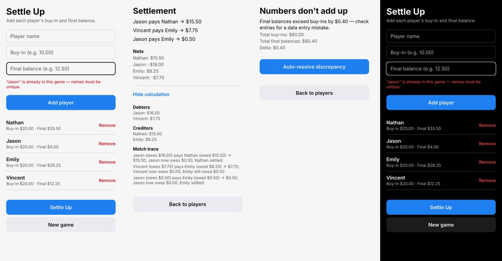
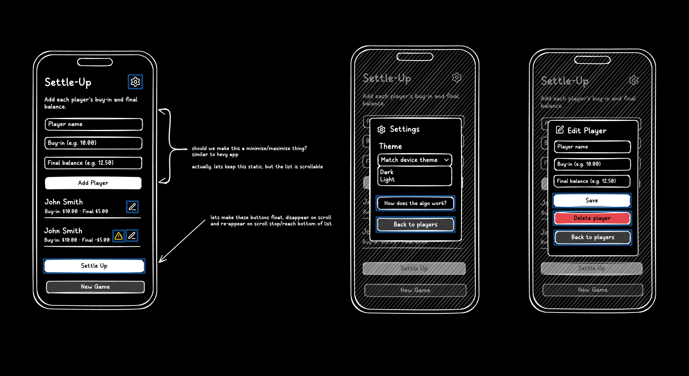

# Settle-Up

A mobile app that resolves who-owes-who at the end of a game night. Enter each player's buy-in and final balance; a Flask backend computes the minimum set of transactions needed to settle all debts, and every result — success or error — shows its underlying math.

## Overview

I built this project around July–August 2026 as a practical application of the agentic coding upskilling I was doing at the time, and I wanted to make sure I wasn't developing bad habits along the way. My friends hold a poker night every few weeks, and after each session we'd calculate payouts by hand or by asking Claude. It was a nicely scoped project that let me put that upskilling into practice.

In short, the app matches the largest debtor with the largest creditor, then repeats with whoever's left, until every player's balance is settled. This keeps the number of payments within our group to a minimum. It also shows its calculation for manual review, catches data-entry mistakes, and offers an optional auto-resolve for edge cases like a lost chip or a rounding error.

## Tech Stack & Development Process

I kept the tech stack fairly basic, since I saw this mainly as a learning exercise:

| Layer   | Choice                                                          |
| ------- | --------------------------------------------------------------- |
| Backend | Python 3.11+, Flask (app factory + blueprints), Pydantic v2, uv |
| Mobile  | React Native with Expo SDK 57, AsyncStorage                     |
| Testing | pytest, pytest-cov                                              |
| Design  | Frame0 for low-fidelity prototyping                             |

The rough development loop with Claude Code was:

1. **Requirements first, by hand.** I wrote the problem, worked examples and milestones in my own notes, then turned them into a Product Requirements Document ([PRD.md](PRD.md)). Open questions stayed open in the PRD until I made a call, and each decision was logged with its reasoning.
2. **Persistent project context.** [CLAUDE.md](CLAUDE.md), [PLANNING.md](PLANNING.md), [TASKS.md](TASKS.md) and [SCRATCHPAD.md](SCRATCHPAD.md) give the agent the domain rules, architecture and current progress at the start of every session. Custom slash commands (`/freshstart`, `/summ+commit`, `/pr`) keep sessions consistent.
3. **Test-driven by rule.** The agent writes failing tests first and may not edit a test to make code pass. The worked examples from the PRD are fixed regression tests.
4. **Every change goes through a PR I review line by line.** I left notes on anything I didn't fully understand. Two PRs ended up closed instead of merged: one surfaced a feature I hadn't specced yet, and the other revealed UX problems I'd overlooked.
   - To assist with this process, I built a workflow with Obsidian, my note-taking app: after I review a PR, Claude files its contents as a new note in my vault. I like keeping my own knowledge in Obsidian so I can find it again later. See [PR #7](https://github.com/Nathan-CSE/Settle-Up/pull/7) for an example of that review process.

By the end, I had a working MVP: the settlement algorithm, input validation, discrepancy resolution and a full test suite.

While the code was being built, I sketched low-fidelity prototypes alongside it. I could have delegated this to Claude too, but I genuinely enjoy the creative side of wireframing, and Frame0 (a free alternative to Balsamiq) is quick to work in. On a larger codebase, I can see myself handing specialised tasks to separate agents and spending my own time reviewing their work and fitting it together into one system.

I stopped before finishing it. After a few trial runs at our poker nights, we realised our group had a simpler option: everyone pays the house up front, and the house pays out at the end. It's a classic case of over-engineering, but I enjoyed the development process.
